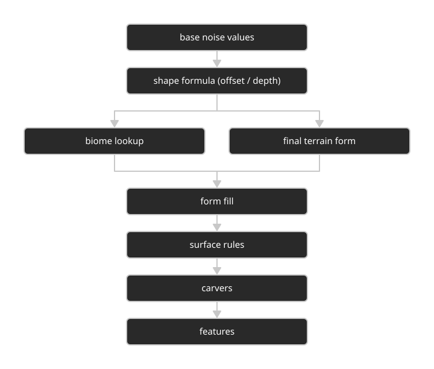
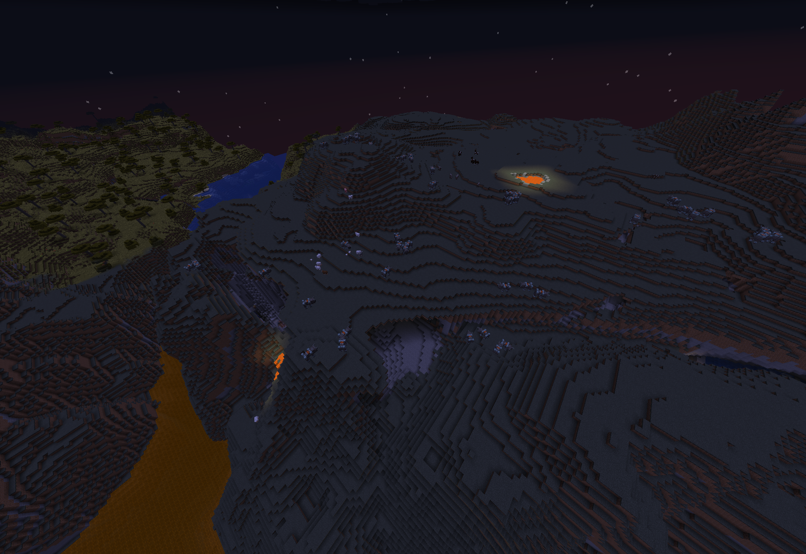
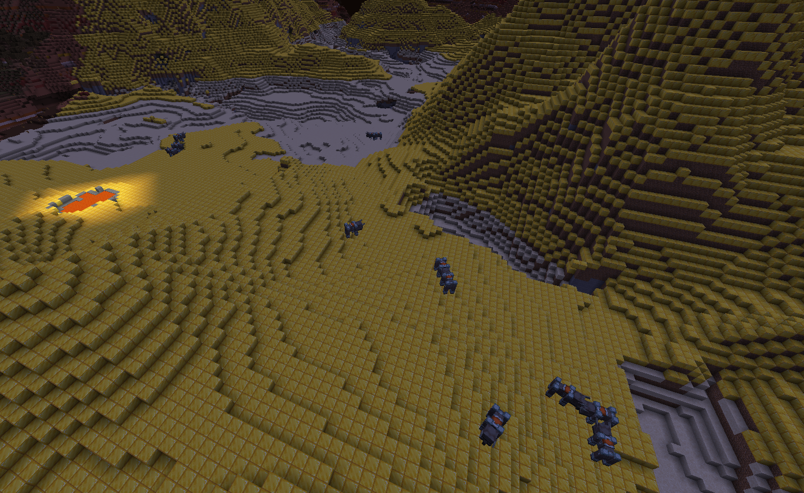

Ah, the biome. What appears to be a basic part of minecraft is obfuscated behind a mountain of confusion in how you implement them.  
Well this tutorial covers 1.20.1 Fabric and will help you understand them.

<i><small>
Lets get something out of the way real fast: this guide relies on a dependency mod. If you reject doing that, get the heck outta here (nicely).
<br><b>
You can skip ahead to the implementation by clicking [here.](#implementation)</b>
</small></i>

To start, you must understand the basics. When there is nothing, you must start with something. In the void, minecraft decides the **base noise values.** These values *describe* the world’s shape, its form, its **characteristics**.  
These are the important base noise values:

| Value | Drives |
| :---- | :---- |
| continentalness | Ocean vs. Inland |
| erosion | Flat vs. Mountainous |
| weirdness | Ridge and Valley shaping, Peaks and Valleys |
| temperature | Biome **only** |
| humidity | Biome **only** |

These are generated as a noise field over the entire world. Any given 3D coordinate x/y/z can sample this field to figure out these values (essentially).

To actually form the world, two major things are decided:

1. The Terrain: Whether it's mountainous, plateau, plains, etc.  
2. The Biome: Taiga, Desert, etc.

Importantly, **these are independent of each other**. (mostly)  
Both Terrain and Biome are decided from the base noise values defined above, aside from this one exception:

* The Biome reads the `depth`. Note that `depth` is **not** the height of the actual blocks. It is the depth calculated by the world generation engine, which is a unitless value that isn’t reflective of the actual block depth of the world.

Therefore, biomes are not tightly coupled to terrain. That does mean biomes cannot control the shape of terrain. However, biomes can perform additive and subtractive operations on the terrain, since biomes sort of run in two stages. The first stage is just deciding what biome each block is in, this happens in conjunction with terrain. The second stage are the effects of the biome. Those will be discussed later on.

You might be wondering how the world generator decides what block is on the surface (grass, sand, etc.). This happens in the surface rules stage. To understand this, let’s first take a quick look at the order of operations in the generation of the world:  

So after the biome is decided and the form of the terrain is decided (mountains, plateaus, etc.), the world is filled up to the top. After filling, selective blocks are replaced with surface rules, which will be explained later. When the surface rules run is decided by the dimension, however the biome is used as a factor in this decision. For example, if the biome is a desert, then the world will choose sand. However, take a mountainous biome. If the surface is very flat, then the desired surface block might be gravel, whereas if it is steep, the desired block is stone. As you can see, the surface block decision needs to take into effect both the terrain form and biome, as a biome can contain many different terrain extremities and properties. One final note is that 1.17 and earlier *did* have the surface block be defined in the biome JSON. So realistically speaking, there isn’t some massive ultimately decisive reason why Mojang changed it to not be in the biome JSON. It’s just what they decided.

## Biome JSON Configs

Now let’s talk about how all of this actually works out in your mod.  
In <span class="inline-path">resources / data / MOD_ID / worldgen / biome</span>, you put your biome configuration file. This is a JSON file that describes a lot about your biome, the most important being:

* `temperature`: affects grass and foliage color, whether precipitation is rain or snow, and whether water will freeze  
* `downfall`: also affects grass and foliage color  
* `has_precipitation`: self-explanatory  
* `temperature_modifier`: if set to `frozen`, the ocean is frozen  
* `sky_color`, `fog_color`, `water_color` and `water_fog_color`: **required**  
* `grass_color` and `foliagecolor`: override the climate-based tint  
* `grass_color_modifier`: none \| dark\_forest \| swamp. swamp varies the color by noise, and dark\_forest darkens it.  
*  `particle`: adds ambient particles (ex. ash) with a probability  
* `ambient_sound`, `mood_sound`, `additions_sound`: background audio (ambience, cave noises)  
* `music`: biome music track and delays  
* `carvers`: A list of subtractive effects, mainly being `cave`, `canyon`, `nether_cave`, and `cave_extra_underground`. Note that even if you omit `cave` from the `carvers` list, the world generation engine will still place caves into each chunk back in the terrain form step. The `cave` option in `carvers` just puts the classic winding tunnel and room caves into your biome. You can read about the cave types that will be generated regardless of `carvers` here: <https://minecraft.wiki/w/Cave>
* `features`: the big one, IMO. This is a list of 11 lists. Let's quickly examine every option for this list. Note that order is technically arbitrary, however for best practices and reducing unexpected behavior (or even crashes), follow this order exactly, including putting empty arrays for features you don’t want to configure.

| Feature | Examples / Common Values |
| :---- | :---- |
| `raw_generation` | Rare to use, not really anything definitive about this feature. It just runs before the rest, so it can be overwritten easily. This could be bad, or good, depending on your goals. |
| `lakes` | Lava Lakes |
| `local_modifications` | Amethyst Geodes, Icebergs |
| `underground_structures` | Monster Rooms, Fossils |
| `surface_structures` | Desert Wells, Blue Ice |
| `strongholds` | deprecated, in a way. A ghost of Minecraft past. You can use it if you want though. |
| `underground_ores` | Gravel, diorite, tuff, coal, iron, etc etc etc. |
| `underground_decoration` | glowstone, magma |
| `fluid_springs` | water, lava |
| `vegetal_decoration` | glow lichen, pumpkins, sugar cane |
| `top_layer_modification` | freeze\_top\_layer, void\_start\_platform |

* `spawners`: Mobs to spawn.  
* `spawn_costs`: Limits how densely specific mobs cluster  
* `creature_spawn_probability`: How often passive mobs will generate when the chunk is created.

Now that sure is a lot of information to throw at you. To see actual examples of vanilla biome configs, check out [mcasset.cloud](https://mcasset.cloud/1.20.1/data/minecraft/worldgen/biome/). Additionally, an extremely helpful tool to generate these configurations with a GUI can be found at [misode.github.io](https://misode.github.io/worldgen/biome/). You can also read a different explaination of all the rules at the [Minecraft Wiki.](https://minecraft.fandom.com/wiki/Custom_biome)


## Decisions, decisions.
**How biomes’ placement is decided.**

At the start, I briefly went over biome decisions and when it occurs. But now let’s get into *how* it actually happens.  
To start, biome placement is determined by the per-dimension settings. So if you are trying to inject biomes into the overworld by yourself, it ends in chaos and destruction. Mod conflicts will occur en masse, and vanilla biomes will not appear. That is where a tool like TerraBlender comes in. Instead of you attempting to inject your biomes into the overworld config file and screwing it all up, TerraBlender is a library mod that provides functions to inject your biomes in a completely safe way. This allows multiple mods to add biomes to the overworld, and vanilla biomes to remain untouched (unless you explicitly overwrite them).  
There are seven parameters that a biome can use to control where it occurs:

| Parameter | Enum Prefix | Possible Values |
| :---- | :---- | :---- |
| `temperature` | `Temperature.` | `ICY`, `FROZEN`, `COOL`, `NEUTRAL`, `WARM`, `HOT`, `UNFROZEN`, `FULL_RANGE` |
| `humidity` | `Humidity.` | `ARID`, `DRY`, `NEUTRAL`, `WET`, `HUMID`, `FULL_RANGE` |
| `continentalness` | `Continentalness.` | `MUSHROOM_FIELDS`, `DEEP_OCEAN`, `OCEAN`, `COAST`, `NEAR_INLAND`, `MID_INLAND`, `FAR_INLAND`, `INLAND`, `FULL_RANGE` |
| `erosion` | `Erosion.` | `EROSION_0`, `EROSION_1`, `EROSION_2`, `EROSION_3`, `EROSION_4`, `EROSION_5`, `EROSION_6`, `FULL_RANGE` |
| `depth` | `Depth.` | `SURFACE`, `UNDERGROUND`, `FLOOR`, `FULL_RANGE` |
| `weirdness` | `Weirdness.` | `MID_SLICE_NORMAL_ASCENDING`, `HIGH_SLICE_NORMAL_ASCENDING`, `PEAK_NORMAL`, `HIGH_SLICE_NORMAL_DESCENDING`, `MID_SLICE_NORMAL_DESCENDING`, `LOW_SLICE_NORMAL_DESCENDING`, `VALLEY`, `LOW_SLICE_VARIANT_ASCENDING`, `MID_SLICE_VARIANT_ASCENDING`, `HIGH_SLICE_VARIANT_ASCENDING`, `PEAK_VARIANT`, `HIGH_SLICE_VARIANT_DESCENDING`, `MID_SLICE_VARIANT_DESCENDING`, `FULL_RANGE` |
| `offset` | none (plain `Float` or `Long`) | a small value that makes a biome less likely<br> to win ties of other values. usually zero. |

All seven of the above values are the ones that you configure using the TerraBlender api mod. Let’s look at an example of a biome definition. This example is what the biome definition might look like for the vanilla Minecraft desert biome, if it were implemented in TerraBlender:
```java
VanillaParameterOverlayBuilder builder = new VanillaParameterOverlayBuilder();

new ParameterPointListBuilder()
    .temperature(Temperature.HOT)
    .erosion(Erosion.span(Erosion.EROSION_4, Erosion.EROSION_5))
    .depth(Depth.SURFACE, Depth.FLOOR)
    .build().forEach(point -> builder.add(point, ModBiomes.MY_DESERT));

builder.build().forEach(mapper);
```
To start off with, we have `VanillaParameterOverlayBuilder` which is the object which you append each of your biome definitions to. Each biome definition is a `ParameterPointListBuilder`, that uses `.parameter1(value).parameter2(value)` syntax to append each of your rules to it. At the end, you call `builder.build().forEach(mapper)` to register all your biome defintions with TerraBlender.

In `.parameter(value)`, value can be three different 'types' of values. First, understand that something like Temperature.HOT is a *range* of values, in this case 0.55 to 1.0:
* just a simple range: for example, `Temperature.HOT`. It's just one specific range. 
* `.span(range1, range2)`: this will produce a continuous range from the lower bound of `range1` and the upper bound of `range2`.
* `(range1, range2, range3, ...)`: this will produce multiple distinct possible ranges the biome can occur in. When you call `.build().forEach(...)`, it will instance every combination of points. If you do this multi-range list `(range1, range2, range3, ...)`, then it will produce multiple point combinations that the biome could occur in.

Quick note: If you do happen to want to copy the exact occurrence condition values of a vanilla biome, you can use `addBiomeSimilar(mapper, Biomes.DESERT, ModBiomes.YOUR_BIOME)`. Similarly, you can replace a vanilla biome (that is, replace every occurence of a vanilla biome with your biome) by doing:  
```java
this.addModifiedVanillaOverworldBiomes(mapper, builder -> {
    builder.replaceBiome(Biomes.DESERT, ModBiomes.MY_DESERT);
});
```

<br>

# IMPLEMENTATION
Now that you have hopefully gained an understanding of the pipeline surrounding biome generation, let's get into actually implementing it. For this tutorial, we are going to make a gold and sand biome that has lava lakes, and lots of ravagers.

<i>Note: I base a lot of this implementation on the example mod setup that the official TerraBlender repository contains.</i>

To start, setup your fabric mod. To not clutter this tutorial, either find your preferred guide to do this or you can follow the [official fabric docs.](https://docs.fabricmc.net/1.20.4/develop/getting-started/introduction-to-fabric-and-modding)

<div class="imgcap">
    <p>Before getting into the weeds of Java, let's define our biome's JSON configuration file. Create a file like so, replacing yourmodid with your mod's id.</p>
    
</div>

Inside `your_biome.json`, we'll add the information regarding our biome. Remember, all of the information that goes in a biome's JSON can be found [here.](#biome-json-configs) Also remember that example vanilla biome config's can be found [here.](https://mcasset.cloud/1.20.1/data/minecraft/worldgen/biome/) I will be using [Misode's biome JSON generator tool.](https://misode.github.io/worldgen/biome/).

My final biome JSON config ended up looking like this. I started with the desert preset and then configured to my liking.
```json
{
  "carvers": {
    "air": [
      "minecraft:cave_extra_underground",
      "minecraft:canyon"
    ]
  },
  "downfall": 0,
  "effects": {
    "fog_color": 15098112,
    "grass_color": 8490104,
    "foliage_color": 8490104,
    "sky_color": 14687012,
    "water_color": 16748288,
    "water_fog_color": 10495232
  },
  "features": [
    [],
    [
      "minecraft:lake_lava_surface"
    ],
    [],
    [],
    [],
    [],
    [],
    [],
    [
      "minecraft:spring_lava"
    ]
  ],
  "has_precipitation": false,
  "spawn_costs": {},
  "spawners": {
    "monster": [
      {
        "weight": 100,
        "type": "minecraft:ravager",
        "minCount": 20,
        "maxCount": 30
      }
    ]
  },
  "temperature": 2
}
```
Next, we'll start using TerraBlender to define our biome's occurence settings and register it to minecraft's overworld dimension. First, add TerraBlender to your `build.gradle` file:

```java
repositories {
    maven { url = 'https://maven.minecraftforge.net/' }
}
dependencies {
    modImplementation 'com.github.glitchfiend:TerraBlender-fabric:1.20.1-3.0.1.7'
}
```

For `modImplementation`, you can get the latest version here: <https://mvnrepository.com/artifact/com.github.glitchfiend/TerraBlender-fabric>

Build your project after this step. Next, we need to hook into the TerraBlender Api in order to register our biomes. To do that, create a new Java class called `TerraBlenderEntrypoint` that implements `TerraBlenderApi` (note: I had to reload IDEA in order for it to pick up on the `TerraBlenderApi` class. There is probably a more elegant way to refresh, but this works fine for me). In that class, put:

```java
import terrablender.api.TerraBlenderApi;

public class TerraBlenderEntrypoint implements TerraBlenderApi {
    @Override
    public void onTerraBlenderInitialized() {
    }
}
```

For now, the method will be empty. Once we define our biomes and regions, we will register them in `onTerraBlenderInitialized`. Next, let's create a `ResourceKey` for our biome. This is essentially a pointer to the JSON file we configured earlier that Fabric and Java can interact with and use. To do this, create a class called `ModBiomes`. Inside of that file, put:

```java
import net.minecraft.core.registries.Registries;
import net.minecraft.resources.ResourceKey;
import net.minecraft.resources.ResourceLocation;
import net.minecraft.world.level.biome.Biome;

public class ModBiomes {
    public static final ResourceKey<Biome> YOUR_BIOME = register("your_biome");

    private static ResourceKey<Biome> register(String name) {
        return ResourceKey.create(Registries.BIOME, new ResourceLocation(YourMod.MOD_ID, name));
    }
}
```

Here, `YOUR_BIOME` is the variable which will store the pointer to our biome JSON file. `"your_biome"` is the filename of the JSON file we configured earlier (minus `.json`). Now that the key is registered, we need to define a `Region` for which our biome will be in. Each region can contain multiple biome point-list definitions (who's info can be found in [Decisions, decisions](#decisions-decisions)). For now, let's just create a simple point list definition for our biome. To do this, create a class named `ModRegion` which extends `Region`. Then put this in the file:

```java
import com.mojang.datafixers.util.Pair;
import net.minecraft.core.Registry;
import net.minecraft.resources.ResourceKey;
import net.minecraft.resources.ResourceLocation;
import net.minecraft.world.level.biome.Biome;
import net.minecraft.world.level.biome.Climate;
import terrablender.api.Region;
import terrablender.api.RegionType;
import terrablender.api.VanillaParameterOverlayBuilder;

import java.util.function.Consumer;

import static terrablender.api.ParameterUtils.*;

public class ModRegion extends Region {
    public ModRegion(ResourceLocation name, int weight) {
        super(name, RegionType.OVERWORLD, weight);
    }

    @Override
    public void addBiomes(Registry<Biome> registry, Consumer<Pair<Climate.ParameterPoint, ResourceKey<Biome>>> mapper) {
        VanillaParameterOverlayBuilder builder = new VanillaParameterOverlayBuilder();

        new ParameterPointListBuilder()
                .temperature(Temperature.HOT)
                .humidity(Humidity.ARID)
                .continentalness(Continentalness.INLAND)
                .erosion(Erosion.FULL_RANGE)
                .depth(Depth.SURFACE)
                .build().forEach(point -> builder.add(point, ModBiomes.YOUR_BIOME));
        
        builder.build().forEach(mapper);
    }
}
```

Now that our region is defined, the last thing to do in Java is to register the region back in the `TerraBlenderEntrypoint` class that we defined earlier. Inside of `onTerraBlenderInitialized`, add the following:

```java
Regions.register(new ModRegion(new ResourceLocation(YourMod.MOD_ID, "lava_and_gold"), 10));
```

This will register the `ModRegion` region with a weight of `10` and a unique identified of `"lava_and_gold"`. Note that this UID can be whatever you want, just make sure it is unique.

Right now we have a problem. While the entire pipeline is defined, nothing kicks it off. So in our `farbic.mod.json` file, we'll add our entry point. Add the following to the "entrypoints" section:

```json
"terrablender": [
    "brendevr.yourmodid.TerraBlenderEntrypoint"
]
```
Load up a world, use `/locate biome yourmodid:your_biome` and check it out!



We have lava lakes, lava springs, brown water, dead grass, and ravagers a'plenty.
But something is missing! I said that this biome would be "gold and sand". To do this, we need to set up **surface rules** .

To start, create a class called `ModSurfaceRuleData`. Inside of this class, we'll define `SurfaceRules.RuleSource` variables which will be values of `Blocks.BLOCK_NAME` converted to TerraBlender-compatible values. For example,
<pre><code>private static final SurfaceRules.RuleSource SAND = makeStateRule(Blocks.SAND);</code></pre>
Next, we'll define the helper method used above, `makeStateRule`:

```java
private static SurfaceRules.RuleSource makeStateRule(Block block) {
    return SurfaceRules.state(block.defaultBlockState());
}
```

Next, we'll setup a method to actually create and register our surface rules.

```java
protected static SurfaceRules.RuleSource makeRules() {
    SurfaceRules.ConditionSource isAtOrAboveWaterLevel = SurfaceRules.waterBlockCheck(-1, 0);
    SurfaceRules.ConditionSource isAbove100 = SurfaceRules.yBlockCheck(VerticalAnchor.absolute(100), 0);

    return SurfaceRules.ifTrue(
            SurfaceRules.isBiome(ModBiomes.YOUR_BIOME),
            SurfaceRules.ifTrue(
                    SurfaceRules.ON_FLOOR,
                    SurfaceRules.sequence(
                            SurfaceRules.ifTrue(isAbove100, GOLD_BLOCK),
                            SurfaceRules.ifTrue(isAtOrAboveWaterLevel, SAND)
                    )
            )
    );
}
```

This took me a while to understand, so I'll do my best to explain. First, understand that `ConditionSource` is essentially just a conditional (as the name suggests) while `RuleSource` is what block should actually be placed based on the result of a `ConditionSource`. The way surface rules work is that work every solid non-liquid block in a x/z column, the conditional tree is ran on it. It will go through the entire tree until a truthy condition is found. If all are falsy for a block, then the block is not overwritten. The first truthy condition is the one that acts upon the block, overwriting what it is.

In my example, I create two basic conditionals at the beginning: `isAtOrAboveWaterLevel` and `isAbove100`.

* `isAtOrAboveWaterLevel`: This one uses `waterBlockCheck` which is a function that checks if a block is above the water level. The first argument `-1` is an offset, in this case any block that is above one block below the water level. The second argument is essentially a smudge value. It's a random value added to the true water elevation. In case you don't want a harsh cutoff.
* `isAbove100`: This checks if a block is at or above y=100. Again, there is a smudge value you can pass in.

Next I define my conditional tree. First I check if the biome is the biome we have been developing thus far, `YOUR_BIOME`. If that is true (the second param of `ifTrue`), then I run a second `ifTrue`. This one checks if the block is `ON_FLOOR`, aka if a given block has a non-solid block above it. If that is true, then I check the block against the two conditions I defined earlier. I do this using a `sequence()` which is equivalent to your classic `if {} else if {}` block in programming. If the block `isAbove100`, then I set it to `GOLD_BLOCK`. If it is not above 100 and at or above the water level, then I set it to `SAND`.

Last step!

In `TerraBlenderEntrypoint.onTerraBlenderInitialized`, add `SurfaceRuleManager.addSurfaceRules(SurfaceRuleManager.RuleCategory.OVERWORLD, YourMod.MOD_ID, ModSurfaceRuleData.makeRules());` to tell TerraBlender about your surface rules. And that's it! Let's check it out in game.



Hooray, it works!

Well, that's it for this tutorial.

If you have any questions, join the discord server and ask away: <https://discord.gg/2QSyRxbd2k>

# Stay creative, godspeed.
<p>- brendevr ♥️</p>